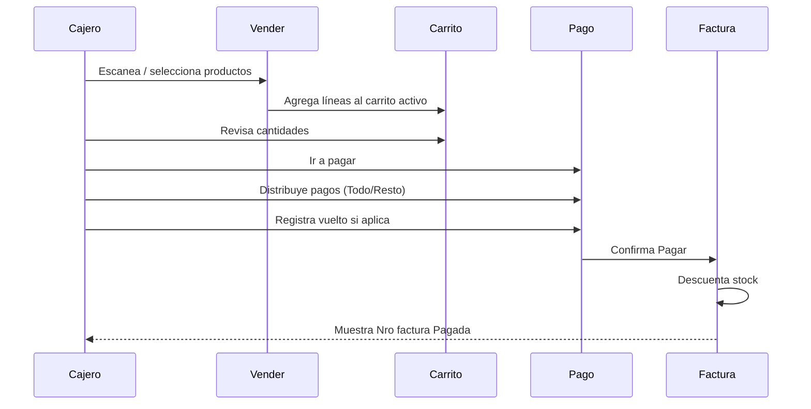

# F01 — Venta de contado (multi-método)

## Actores

Cajero.

## Precondiciones

- Sesión activa.
- Tasa configurada.
- Al menos un producto en catálogo.

## Flujo principal

## Pasos detallados

1. En **Vender**, elegir Cliente 1 o 2 (carrito).
2. Agregar productos:
   - Pistola: escaneo → +1 unidad si barcode existe.
   - Tap: +1 o modal cantidad/peso.
3. Abrir **Carrito**; ajustar cantidades.
4. **Pagar**:
   - Verificar totales USD/Bs.
   - Sin “venta a crédito”.
   - Ingresar montos por medio hasta cubrir total.
   - Usar **Resto** en último medio si aplica.
   - Si hay vuelto, completar vuelto en Bs/divisas/pago móvil.
5. Confirmar **Pagar**.
6. Sistema genera factura **Pagada** y vacía carrito.

## Postcondiciones

- Stock actualizado.
- Factura visible en **Facturas de ventas** (hoy).
- Totales del día incrementados.

## Excepciones

| Caso | Respuesta |
|------|-----------|
| Carrito vacío | Bloquear pago |
| Stock insuficiente | Permitir venta; stock puede quedar negativo (sin confirmación) |
| Offline | Misma UX; factura en cola sync |
| Pago &lt; total | Error referencia |

## Datos mínimos capturados

- Líneas, tasa, pagos por método, vuelto, timestamp, device_id.
