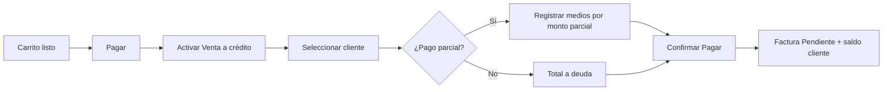

# F02 — Venta a crédito (fiado)

## Actores

Cajero, cliente fiado.

## Precondiciones

- Cliente registrado (o crear antes de cobrar).
- Productos en carrito.

## Flujo principal

## Pasos

1. Completar carrito normalmente.
2. En **Pagar**, marcar **Venta a crédito**.
3. Elegir **Cliente** (obligatorio).
4. Opcional: registrar pago parcial en cualquier medio.
5. Confirmar **Pagar**.
6. Monto no cubierto se suma a deuda del cliente.
7. Factura queda **Pendiente** (o Pagada parcial si se implementa sub-estado).

## Postcondiciones

- Deuda cliente actualizada (USD maestro).
- Factura en listado del día con cliente visible.
- Stock descontado (fiado sigue siendo venta de mercancía).

## Reglas

- No permitir crédito sin cliente.
- Límite de crédito por cliente (fase 2): alerta si supera tope.

## Abono posterior

Ver [F05-abono-deuda.md](./F05-abono-deuda.md).
