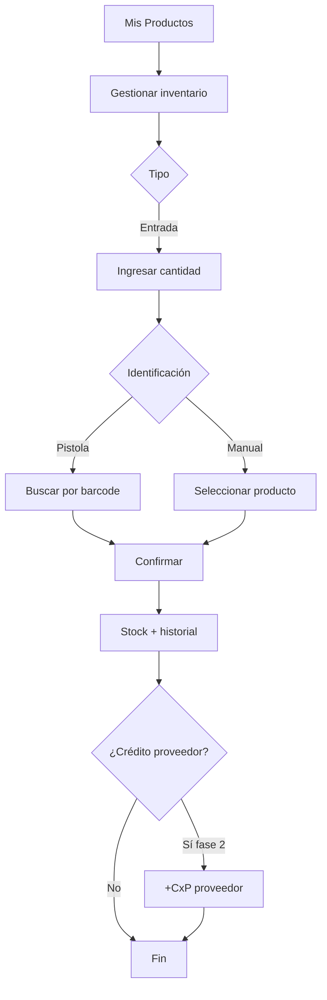

# F03 — Compra / entrada de inventario

## Actores

Dueño o encargado de compras.

## Objetivo

Incrementar stock por compra en mercado/distribuidor; opcionalmente registrar deuda con proveedor (fase 2).

## Flujo principal

## Pasos (MVP)

1. Abrir producto → **Gestionar inventario**.
2. Elegir **Entrada** / Compra inventario.
3. Indicar **Unidades/Kg a ingresar**.
4. Confirmar → mensaje “stock incrementado”.
5. Registro en historial de inventario.

## Pistola

Modo inventario: escaneo repetido suma +1 o abre cantidad editable.

## Postcondiciones

- `in_stock` actualizado.
- Movimiento `Compra_Inventario` en historial.

## Excepciones

- Producto inactivo → no permitir entrada sin reactivar.
- Offline → cola movimiento; stock local optimista.
