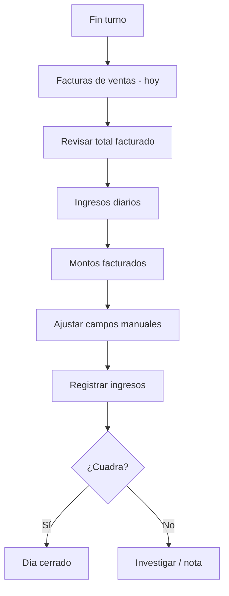

# F04 — Cierre del día

## Actores

Dueño / cajero autorizado.

## Objetivo

Conciliar ventas del día con lo contado en caja por medio.

## Flujo

## Pasos

1. Ir a **Contabilidad → Facturas de ventas**.
2. Filtrar **hoy**; anotar desglose USD, POS, pago móvil, efectivo Bs, biopago.
3. Ir a **Ingresos diarios**.
4. Pulsar **Montos facturados** (precarga).
5. Ajustar si hay diferencia real (propinas fuera de sistema, ventas no registradas, etc.).
6. **Registrar ingresos**.
7. Verificar registro en **Últimos 30**.

## Reglas

- No borrar facturas del día sin permiso admin.
- Si se re-registra mismo día → editar registro existente (evitar duplicados).

## KPIs mostrados

- Total general USD.
- Total Bs por medio.
- Cantidad de facturas (referencia: “14 facturas”).

## Offline

- Facturas offline incluidas en totales locales.
- Al sync, recalcular “Montos facturados” antes de cerrar definitivamente.
