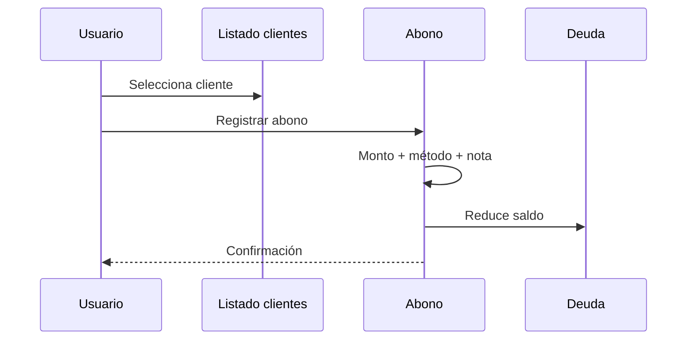

# F05 — Abono de deuda (cliente o proveedor)

## Actores

Cajero / dueño.

## Alcance

- **Cliente**: reduce fiado (`Abono_Deuda`).
- **Proveedor / acreedor** (fase 2): reduce CxP.

## Flujo cliente

## Reglas

- Abono no puede exceder deuda (salvo “a favor” intencional).
- Generar comprobante interno opcional.
- Si hay módulo cuentas: abono suma a caja lógica correspondiente.

## Offline

- Abono en cola; deuda local actualizada de inmediato.

## Referencia tipos movimiento

- `Abono_Deuda`
- `Abono_Prestamo_Externo`
