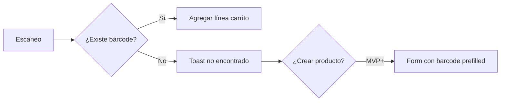

# F06 — Uso de pistola (venta e inventario)

## Objetivo

Operación manos libres con escáner HID en PWA.

## Configuración operativa

- Escáner en modo **keyboard wedge**.
- Sufijo **Enter** tras código (recomendado).
- Campo foco: input “Escaneo” invisible en pantallas de caja.

## Modos

| Modo | Pantalla | Acción |
|------|----------|--------|
| VENTA | Vender | +1 al carrito activo |
| INVENTARIO_ENTRADA | Gestionar inventario | +cantidad entrada |
| INVENTARIO_SALIDA | Gestionar inventario | +cantidad salida |
| ALTA_PRODUCTO | Form producto | set barcode |

## Algoritmo detección escaneo vs tipeo humano

1. Acumular caracteres en buffer.
2. Si tiempo entre teclas &lt; 40 ms → marcar como escaneo.
3. Al recibir Enter → procesar buffer completo.
4. Limpiar buffer.

## Flujo venta

## Productos por peso

- Si unidad = Kg/Gramos, escaneo abre modal cantidad (no asumir 1 kg).

## Duplicados

- Mismo barcode en dos productos → error datos; bloquear y pedir corrección admin.

## Pruebas de aceptación

- 10 escaneos seguidos &lt; 5 s en carrito.
- Funciona offline con catálogo cacheado.
- No dispara acciones si foco está en nota de pago (configurable).

## Diferencia vs referencia FlutterFlow

Referencia incluye **Escanear texto** (OCR cámara) para búsqueda; BodePOS prioriza pistola HID en MVP.
