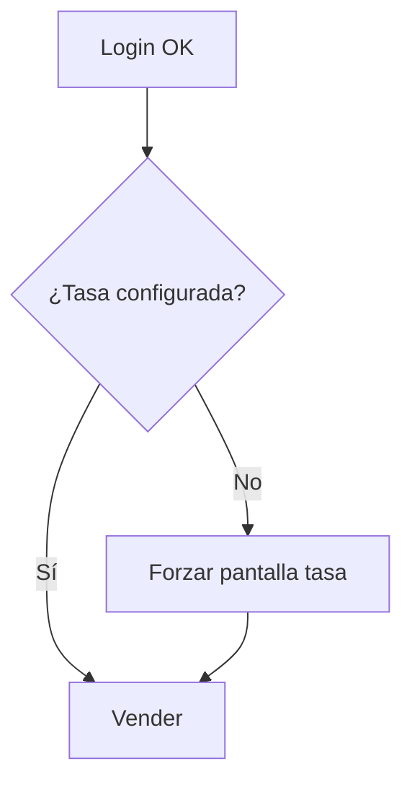

# Módulo: Autenticación y configuración

## Objetivo

Acceso seguro a la bodega y parámetros globales (tasa, sesión, versión).

## Pantallas

### Login (referencia: `/`)

| Elemento | Comportamiento |
|----------|----------------|
| Email | Requerido, formato email |
| Contraseña | Requerido, toggle visibilidad |
| Entrar | Autentica; redirige a Vender |
| Crear usuario | Registro (solo si habilitado por negocio; MVP puede desactivar) |

**Offline**: permitir login solo si sesión previa válida en dispositivo (token refresh en cache); si no hay sesión → mensaje “Conecte a internet para iniciar”.

### Configuración — “Más” (referencia: `/settingsPage`)

| Opción | Descripción |
|--------|-------------|
| Tasa personalizada | Ver/editar tasa |
| Reporte de inventario | Export/listado stock |
| Cerrar sesión | Limpia tokens; mantiene o purga cache (configurable) |
| Versión | Mostrar build (ej. 1.0.0) |

### Tasa personalizada (referencia: `/customRatesPage`)

| Campo | Reglas |
|-------|--------|
| Tasa personalizada | Decimal &gt; 0 |
| Usar siempre esta tasa | Si activo, ignorar tasa BCV automática |
| Guardar cambios | Persiste; actualiza badge en Vender |

**Fase 2**: consulta tasa BCV (`bcv_rate`) con fallback a manual si API falla (mensajes ya existen en referencia).

## Flujo: primera configuración

## Datos

| Entidad | Campos clave |
|---------|----------------|
| User | id, email, tenant_id, role |
| TenantSettings | custom_rate, use_fixed_rate, low_stock_default |

## Errores

- Credenciales inválidas.
- Sin conexión en primer login.
- Tasa no configurada al intentar vender (bloqueo suave con enlace a settings).
