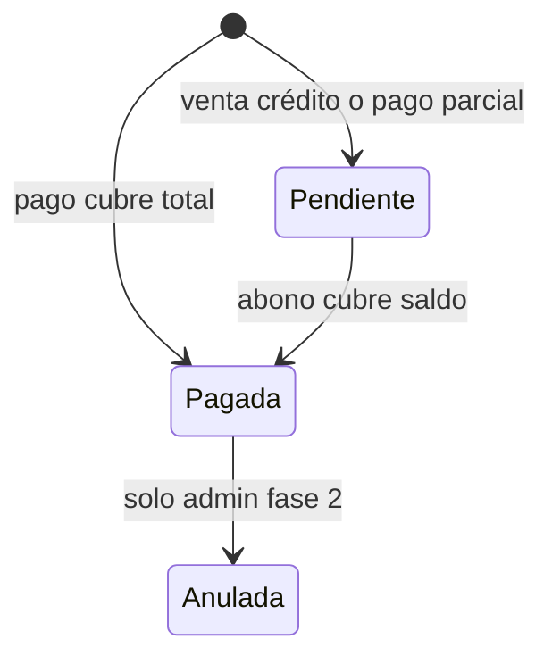

# Módulo: Ventas (POS)

## Objetivo

Flujo rápido de caja: multi-carrito, búsqueda, pistola, carrito, pago, factura.

## Pantallas

### Vender (`/productsSelectionPage`)

| UI | Comportamiento |
|----|----------------|
| Cliente 1 / 2 / 3 | Tres carritos independientes (`cart_slot` 1..3; referencia FlutterFlow tenía 2 visibles y 4 en estado) |
| Tasa 1$ = X | Solo lectura; link a config (admin) |
| Calculadora | Utilidad aritmética (opcional MVP) |
| Icono carrito | Badge cantidad ítems → `/cartPage` |
| Búsqueda | Por nombre; **+ barcode vía pistola** |
| Cantidad por tarjeta | Input en cada producto: unidades o gramos/kg; **actualiza el carrito al escribir** |

### Carrito (`/cartPage`)

| Estado | UI |
|--------|-----|
| Vacío | “No hay nada en el carrito” |
| Con ítems | Líneas: producto, cantidad, $, Bs; editar qty; eliminar línea |
| Acciones | Vaciar carrito (confirmación), Ir a pagar |

**Validaciones**

- No pagar carrito vacío.
- Cantidad &gt; 0; respetar unidad kg si aplica.
- Stock puede quedar negativo **sin confirmación** (solo indicador visual).

### Pago (`/paymentPage`)

| Sección | Campos |
|---------|--------|
| Totales | Total USD, Total Bs (calculados) |
| Crédito | Checkbox venta a crédito + selector cliente |
| Pagos | Divisas, POS, pago móvil, Bs efectivo, biopago |
| Atajos | Todo / Resto por fila |
| Vuelto | Total vuelto USD/Bs + distribución |
| Acciones | Volver, **Pagar** |

### Post-pago

- Crear **invoice** + líneas.
- Decrementar stock por línea.
- Limpiar carrito activo.
- Mostrar resumen / opción imprimir (fase 2).

## Línea de carrito (modelo)

| Campo | Tipo |
|-------|------|
| product_id | uuid |
| product_name | snapshot |
| quantity | number |
| unit | enum |
| unit_price_usd | snapshot al agregar |
| line_total_usd | calc |

## Factura (cabecera)

| Campo | Notas |
|-------|-------|
| invoice_number | serial |
| status | Pagada / Pendiente |
| customer_id | nullable |
| rate_applied | tasa al momento |
| total_usd, total_bs | |
| paid_* | por método |
| change_* | vuelto |
| is_credit | bool |
| created_at | |
| sync_status | offline |

## Estados factura

## Errores (referencia)

- Producto no encontrado.
- El monto pagado es menor al total de la factura.
- Métodos de pago requerido.
- Debes registrar el vuelto entregado.
- Cliente requerido (crédito).
- Divisas y punto de venta deben tener un valor (validación contextual en ingresos diarios).

## Multi-carrito

- Máximo **3** carritos (decisión BodePOS).
- Cambiar pestaña no pierde carrito en memoria local.
